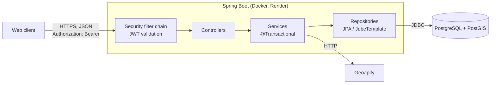
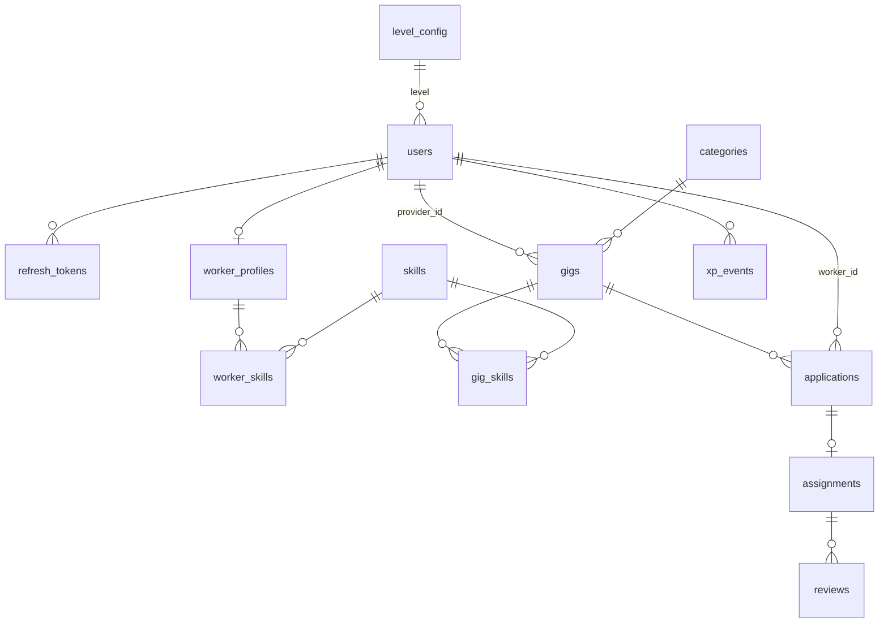

# JFJ (Job For Jobless)

[](https://github.com/Bivek-D/JFJ/actions/workflows/ci.yml)

Location-based marketplace for short-term local work (gigs). Providers post gigs with a location. Workers find them by distance or on a map, apply and get hired. Both sides rate each other after a job.

This repository is a monorepo:

- `backend/`: REST API (Spring Boot, PostgreSQL + PostGIS)
- `frontend/`: web client (React + Leaflet, in progress)

| | |
|---|---|
| Frontend | https://jfj-roan.vercel.app/ |
| OpenAPI / Swagger UI | https://jfj-s529.onrender.com/swagger-ui.html |
| Health | https://jfj-s529.onrender.com/actuator/health |

The API runs on Render's free tier, so the first request after an idle period can take up to a minute.

---

## Contents

- [Tech stack](#tech-stack)
- [Architecture](#architecture)
- [Data model](#data-model)
- [Domain rules](#domain-rules)
- [Implementation notes](#implementation-notes)
- [API](#api)
- [Configuration](#configuration)
- [Running locally](#running-locally)
- [Testing](#testing)
- [CI/CD](#cicd)
- [Project structure](#project-structure)
- [Not yet implemented](#not-yet-implemented)

---

## Tech stack

| Area | Choice |
|---|---|
| Runtime | Java 21 |
| Framework | Spring Boot 4.1: Web MVC, Data JPA, Security, Validation, Actuator |
| Auth | Spring Security OAuth2 Resource Server, HS256 JWT, BCrypt |
| Database | PostgreSQL 17 + PostGIS 3 (Supabase in production, `postgis/postgis` image locally) |
| Spatial | Hibernate Spatial, JTS, SRID 4326 |
| Data access | Spring Data JPA; `NamedParameterJdbcTemplate` for search queries |
| Migrations | Flyway |
| API docs | springdoc-openapi 3 |
| Geocoding | Geoapify (proxied through the backend) |
| Tests | JUnit 5, MockMvc, Testcontainers |
| Build / deploy | Maven wrapper, Docker (multi-stage), GitHub Actions, Render |

---

## Architecture



- **Stateless.** No server-side sessions. Each request carries an access token, and the token's claims (`sub`, `role`, `mode`) are enough to authorize it without a database lookup.
- **Layering.** Controllers handle HTTP, validation and DTO mapping. Services own business rules and transaction boundaries. Repositories handle persistence. Entities are never returned directly; responses are Java records in `dto/response`.
- **Errors.** One `@RestControllerAdvice` maps exceptions to a single error body. Spring Security's 401/403 responses go through the same format via a custom entry point and access-denied handler.

---

## Data model



| Table | Purpose | Notable constraints / indexes |
|---|---|---|
| `users` | Accounts (one account, two modes) | `email`, `phone` unique; GiST on `location`; cached rating and XP totals |
| `refresh_tokens` | Refresh sessions | `token_hash` (SHA-256) unique; `revoked`, `expires_at` |
| `worker_profiles` | Worker-only fields | PK = FK to `users` (1:1) |
| `skills`, `worker_skills` | Skill catalogue, worker ↔ skill | composite PK |
| `categories` | Gig categories | `sort_order`, `active` |
| `gigs` | Posted work | `location` (exact) and `public_location` (offset); GiST on `public_location` and `public_location::geography`; generated `search_vector` with GIN index; status `CHECK` |
| `gig_skills` | Gig ↔ skill | `ON DELETE CASCADE` |
| `applications` | Worker applies to gig | `UNIQUE (gig_id, worker_id)` |
| `assignments` | Hired worker on a gig | `application_id` unique; `UNIQUE (gig_id, worker_id)` |
| `reviews` | 1–5 rating, either direction | `UNIQUE (assignment_id, reviewer_id)` |
| `xp_events` | Append-only XP ledger | `UNIQUE (user_id, event_type, ref_id, version)` |
| `level_config` | Level thresholds | 5 rows: 0 / 60 / 200 / 450 / 900 XP |

The schema is created only by Flyway (`backend/src/main/resources/db/migration`, V1–V7). Hibernate runs with `ddl-auto: validate`.

---

## Domain rules

**Modes.** A user is in `WORKER` or `PROVIDER` mode, stored in the token. `POST /auth/switch-mode` issues new tokens. `@WorkerOnly` and `@ProviderOnly` are meta-annotations over `@PreAuthorize`.

**Gig lifecycle**

```
DRAFT ──publish──▶ OPEN ──start──▶ IN_PROGRESS ──complete──▶ COMPLETED
                    │                   │
                    └──────cancel───────┴──▶ CANCELLED   (reason required)
OPEN ──(start date / deadline passed)──▶ excluded from search
```

- `start` requires at least one active assignment.
- `complete` marks every active assignment `COMPLETED`, rejects pending applications and awards XP.
- `cancel` marks active assignments `REMOVED` and rejects pending applications.

**Applications:** `APPLIED → SHORTLISTED → HIRED`, or `REJECTED` / `WITHDRAWN`. Hiring creates an `assignment`. There is no `FULL` gig status: the remaining openings are always `workers_needed − count(active assignments)`.

**Contact reveal:** `GET /assignments/{id}/contact` returns the other party's name and phone.

| Assignment status | Worker | Provider |
|---|---|---|
| `ACTIVE` | yes | yes |
| `COMPLETED` | 7 days after end | 7 days after end |
| `REMOVED` | no | 7 days after end |

Callers who aren't one of the two parties get `404`.

**XP**

| Event | Points |
|---|---|
| Gig completed (worker) | +20 |
| Gig completed (provider) | +10 |
| Profile completed | +10 |
| Rating received: 5 / 4 / 3 / 2 / 1 stars | +10 / +5 / 0 / −5 / −10 |

A gig can set `min_level`. Applicants below that level are refused.

---

## Implementation notes

### Concurrent hiring

Hire, start, complete and cancel load the gig with `@Lock(PESSIMISTIC_WRITE)` (`SELECT … FOR UPDATE`) before checking state. Concurrent operations on the same gig run one after another, so the openings check and the insert cannot interleave. `HiringConcurrencyTests` submits 8 hires in parallel against a gig with 3 openings and asserts 3 successes, 5 refusals and 3 assignment rows.

### Location privacy

On create, and when the location changes, `GeoUtils.approximate` moves the exact point 300–500 m in a random direction (spherical destination-point formula) and stores the result in `public_location`. The offset is generated once per exact point and not per request, so repeated queries can't be averaged back to the real point. All search, map and distance queries read only `public_location`. The exact address is returned only to the gig owner and to hired workers. Location edits are capped at 3 per gig.

JTS and PostGIS use `(x, y) = (lng, lat)` while the API uses `lat, lng`; every conversion goes through `GeoUtils.point/lat/lng`.

### Search

`GigSearchRepository` builds SQL from the filters that were sent. All values are bound as named parameters.

- **List** (`GET /gigs`): `ST_DWithin(public_location::geography, :here, :radiusM)`, ordered by `ST_Distance`, then `created_at DESC, id` for stable pagination.
- **Map** (`GET /gigs/map`): `public_location && ST_MakeEnvelope(...)` (index-backed bounding-box test), capped at 200 pins.
- **Keyword:** `search_vector @@ websearch_to_tsquery(...)` on a stored generated `tsvector` of title + description (supports quoted phrases and `-exclusions`).
- **Always applied:** status `OPEN`, provider `ACTIVE`, start date and apply deadline not passed.

### Authentication

| Token | Format | Lifetime | Storage |
|---|---|---|---|
| Access | HS256 JWT (`sub`, `role`, `mode`) | 15 min | client memory |
| Refresh | 32 random bytes, base64url | 7 days | `HttpOnly` cookie; DB stores SHA-256 only |

Refresh tokens rotate on every `/auth/refresh`, and the old token is revoked. Registration requires age ≥ 18, calculated in `Asia/Kolkata`.

### XP consistency

`xp_events` is the source of truth, and `users.total_xp` / `users.level` are a cache updated in the same transaction. The `XpService` methods use `Propagation.MANDATORY`, so they must run inside a caller's transaction. Affected users are locked with `SELECT … FOR UPDATE` in sorted-ID order to avoid deadlocks. Each award checks for an existing `(user, type, ref, version)` before inserting, and the unique constraint backs that check, so retries are idempotent. Negative awards are clamped so `total_xp` never drops below 0.

### Geocoding proxy

`/geo/autocomplete` and `/geo/reverse` call Geoapify from the server, so the API key never reaches the client. Each call is rate-limited per user (30/min) and cached (TTL 10 min, reverse lookups rounded to 4 decimals). Connect and read timeouts are 3 s / 5 s. Search text, coordinates and upstream error messages are not logged. If no key is configured, the endpoints return `503`.

---

## API

Base path `/api/v1`. Full schemas are in Swagger UI.

| Method | Path | Access |
|---|---|---|
| POST | `/auth/register`, `/auth/login`, `/auth/refresh`, `/auth/logout` | public |
| POST | `/auth/switch-mode` | authenticated |
| GET | `/skills`, `/categories` | public |
| GET | `/users/me` | authenticated |
| GET | `/workers/me/profile` | authenticated |
| PUT | `/workers/me/profile`, `/workers/me/skills` | worker |
| GET | `/workers/{userId}` | authenticated |
| POST | `/gigs` | provider |
| PUT / DELETE | `/gigs/{id}` | provider (owner) |
| POST | `/gigs/{id}/publish`, `/start`, `/complete`, `/cancel` | provider (owner) |
| GET | `/gigs/mine` | provider |
| GET | `/gigs` (list), `/gigs/map`, `/gigs/{id}` | authenticated |
| GET | `/geo/autocomplete`, `/geo/reverse` | authenticated |
| POST | `/gigs/{gigId}/applications` | worker |
| GET | `/applications/mine` | worker |
| DELETE | `/applications/{id}` | worker (owner) |
| GET | `/gigs/{gigId}/applications` | provider (owner) |
| POST | `/applications/{id}/shortlist`, `/reject`, `/hire` | provider (owner) |
| GET | `/assignments/mine` | worker |
| GET | `/assignments/{id}/contact` | assignment parties |
| POST | `/assignments/{id}/reviews` | assignment parties |
| PUT | `/reviews/{id}` | reviewer |
| GET | `/users/{id}/reviews` | authenticated |
| GET | `/gigs/{id}/reviews/pending` | provider (owner) |

Error body (all 4xx/5xx):

```json
{
  "timestamp": "2026-11-10T09:15:02Z",
  "status": 400,
  "error": "Bad Request",
  "message": "No openings left: all 3 places are filled",
  "path": "/api/v1/applications/7c1e…/hire",
  "fieldErrors": {}
}
```

`fieldErrors` maps field name → message for validation failures.

---

## Configuration

Profiles: `dev` (default) and `prod`. In `dev`, values are read from `backend/.env`, which is git-ignored. In `prod`, they come from environment variables.

| Variable | Required | Notes |
|---|---|---|
| `DB_URL` | yes | JDBC URL, e.g. `jdbc:postgresql://localhost:5433/jfj` |
| `DB_USERNAME`, `DB_PASSWORD` | yes | |
| `DB_NAME` | local only | used by `docker-compose.yml` |
| `FLYWAY_URL` | prod | direct (non-pooled) connection for migrations |
| `JWT_SECRET` | prod | ≥ 32 characters; dev has a fallback |
| `JWT_ACCESS_TTL_MIN` | no | default 15 |
| `JWT_REFRESH_TTL_DAYS` | no | default 7 |
| `GEOAPIFY_API_KEY` | no | geo endpoints return 503 without it |

Actuator exposes only `health` and `info`. `info.app.commit` reports `RENDER_GIT_COMMIT`.

---

## Running locally

Requirements: JDK 21 and Docker.

```bash
git clone https://github.com/Bivek-D/JFJ.git
cd JFJ/backend

cp .env.example .env          # set DB_NAME, DB_USERNAME, DB_PASSWORD, DB_URL
docker compose up -d          # PostGIS on localhost:5433
./mvnw spring-boot:run        # Flyway migrates on startup
```

Swagger UI: http://localhost:8080/swagger-ui.html

---

## Testing

```bash
cd backend
./mvnw verify
```

100 tests. Integration tests start a `postgis/postgis` container through Testcontainers (`TestcontainersConfiguration`), so Docker must be running. No in-memory database is used: migrations, constraints and spatial queries run against real PostGIS.

| Area | Classes |
|---|---|
| Auth and security | `AuthRegisterTests`, `AuthLoginTests`, `AuthSessionTests`, `ModeRulesTests`, `SecurityErrorBodyTests` |
| Profiles | `WorkerProfileTests` |
| Gigs and search | `GigTests`, `GigSearchTests`, `GigLifecycleTests` |
| Hiring | `ApplicationTests`, `HiringConcurrencyTests` |
| Reviews and XP | `ReviewXpTests` |
| Geo | `GeoUtilsTests`, `GeoHelpersTests`, `GeoTests` (Geoapify stubbed with an in-process HTTP server) |
| Misc | `RepositoryMappingTests`, `AgeUtilsTests`, `HealthEndpointTests`, `OpenApiTests`, `JfjApplicationTests` |

---

## CI/CD

`.github/workflows/ci.yml`:

| Job | Trigger | Steps |
|---|---|---|
| `path-guard` | PRs from forks | fails if anything outside `frontend/` changed |
| `backend` | PRs and pushes to `main` | `./mvnw -B verify`, then `docker build` |
| `frontend` | PRs and pushes to `main` | placeholder until `frontend/package.json` exists |
| `deploy` | push to `main`, after `backend` + `frontend` | requires approval on the `production` environment; triggers the Render deploy hook for the exact commit SHA; polls `/actuator/info` until that SHA is live (max 10 min), then asserts `/actuator/health` is `UP` |

The Dockerfile is multi-stage. A JDK 21 image builds the jar (tests skipped, because CI runs them), and a JRE 21 image runs it as a non-root user.

---

## Project structure

```
backend/
├── Dockerfile
├── docker-compose.yml            # local PostGIS
├── .env.example
└── src/
    ├── main/java/com/jfj_backend/JFJ/
    │   ├── config/               # OpenAPI, Geoapify properties
    │   ├── controller/
    │   ├── dto/request|response/
    │   ├── entity/
    │   ├── enums/
    │   ├── exception/            # exception types + GlobalExceptionHandler
    │   ├── repository/           # JPA repositories, GigSearchRepository (SQL)
    │   ├── security/             # SecurityConfig, JwtConfig, TokenService, @WorkerOnly/@ProviderOnly
    │   ├── service/
    │   └── util/                 # GeoUtils, RateLimiter, TtlCache, AgeUtils
    ├── main/resources/
    │   ├── application.yml, application-dev.yml, application-prod.yml
    │   └── db/migration/         # V1–V7
    └── test/java/...             # see Testing
frontend/                          # in progress
.github/workflows/ci.yml
```

---

## Not yet implemented

- Scheduled jobs: mark gigs `EXPIRED`, auto-start on start date (search already filters past-date gigs)
- Email / phone verification (columns exist, no flow)
- Notifications
- Admin endpoints (account suspension, category and level management)
- Photo upload (`photo_url` column exists, no storage)
- Frontend
